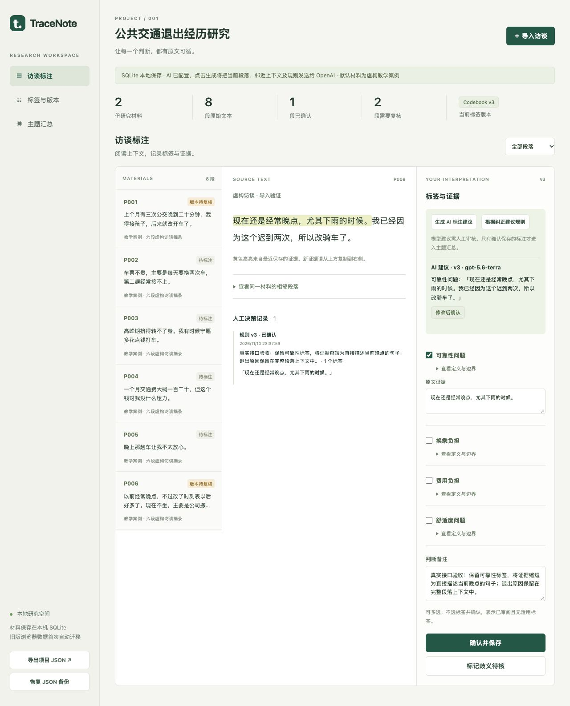

# TraceNote

An evidence-linked qualitative research workbench with AI coding suggestions, human review, and versioned codebooks.

TraceNote helps researchers examine interview excerpts, define coding boundaries, review model suggestions, and trace a theme back to the original text. The working demo uses fictional interviews about leaving public transportation.

[中文说明](README.zh-CN.md) · [Architecture](docs/architecture.md) · [Demo walkthrough](docs/demo.md) · [Evaluation protocol](eval/README.md)



## What works

- Import TXT or pasted text; preserve paragraphs and stable source IDs.
- Assign multiple labels with exact source quotations and character offsets.
- Generate structured AI suggestions through a server-side OpenAI Responses adapter.
- Accept, modify, or reject suggestions; unreviewed suggestions do not enter confirmed summaries.
- Propose codebook changes from reviewer notes, inspect a diff, and explicitly publish a new version.
- Queue older decisions for review after a rule change; preserve previous decisions and versions.
- Store project snapshots in SQLite with revision conflict protection.
- Export JSON; restore the manual research records while retaining the pre-restore database snapshot.

This is a local, single-user prototype. The UI is primarily Chinese. The four initial labels are editable; creating additional labels through the UI is not implemented.

## Run locally

Requires Python 3.10+. The server uses the standard library; no Python packages or frontend build are required.

```sh
python3 server.py
```

Open **http://localhost:8767/**. Run from the extracted repository directory. The server binds to loopback only. Do not start it with a static HTTP server: the UI requires its API.

On first use, an empty database imports the current browser's legacy TraceNote project if available; otherwise it starts with the fictional demo. Data is stored in `data/tracenote.sqlite3`, which is excluded from the source package.

### Optional model configuration

Copy `.env.example` to `.env` and fill in `OPENAI_API_KEY` and `TRACENOTE_MODEL` locally. Use a model available to your account that supports Responses structured outputs. Restart the server after configuration changes.

Manual coding works without credentials. Model buttons remain disabled until both values are set. Clicking Generate sends the current paragraph, adjacent context, and codebook to OpenAI. Rule suggestions additionally use the relevant reviewer note and prior suggestion. Requests set `store: false`; credentials remain server-side and are not included in database snapshots or exports.

## Tests

Requires Node.js 18+ for the frontend domain tests.

```sh
python3 -m unittest discover -s tests -p 'test_*.py' -v
node --test tests/domain.test.js
```

The current suite contains 16 Python tests and 7 JavaScript tests. It covers source evidence validation, Unicode offsets, immutable history, stale versions, conflicting writes, suggestion decisions, HTTP boundaries, and evaluation scoring. Backend tests inject a clearly named fake model; there is no production fake-model mode.

## Evaluation and evidence

The first benchmark used **16 assistant-authored synthetic cases**, with one response per case and arm. Direct prompting and the workbench prompt both matched all reference label sets; each arm's 14 quotations passed exact-source and unique-location checks. **No accuracy advantage was observed.**

- [Original results, including raw inputs and outputs](eval/results/synthetic-v1/report.md)
- [Multi-paragraph follow-up](eval/results/context-v2/report.md) and [interpretation](eval/context-findings.md)
- [Methodology and independent-review plan](eval/README.md)

These are development benchmarks, not independent human gold labels or evidence of real-world accuracy. Exact quotation matching does not establish semantic support. Researcher agreement, human review time, and generalization to real interviews have not been measured. Results from repeated paragraphs in one interview must not be treated as statistically independent.

A real browser walkthrough has verified model generation, acceptance, edited acceptance, codebook suggestion publication, stale-review queuing, and summary-to-source navigation. The displayed screenshot contains fictional demo material and development-review decisions.

## Engineering decisions

The domain logic is separate from the UI. Server-side validation rejects unknown labels, invalid source offsets, and fabricated or non-unique model quotations. A model response remains attached to the codebook version used for its request. Review decisions are appended rather than silently overwriting history.

SQLite stores complete JSON snapshots for transparent history and simple conflict handling. This trades storage efficiency for implementation simplicity and is not a large-corpus design. Model calls are synchronous with a 60-second timeout; persisted task states and request IDs prevent simple duplicate submissions. Failed paid calls are not automatically retried.

See [architecture and known limits](docs/architecture.md) for details.

## Repository map

```text
backend/        validation, SQLite, model adapter, suggestion lifecycle
web/            browser UI and standalone domain logic
server.py       local HTTP API and static assets
tests/            backend, HTTP, scoring and browser-domain tests
eval/           frozen synthetic cases, runners and recorded results
docs/           architecture, demo and product plan
scripts/        curated source-package builder
```

## Next work

Independent blind annotation and adjudication; full-length interview evaluation; controlled review-time study; stronger project recovery and corpus management; a separately designed public demo with authentication and usage limits. The source is maintained in the private GitHub repository `zbchen0129-crypto/trace-note`. There is no public hosted deployment.
