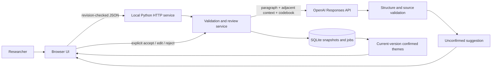

# Architecture

## Persistence contract

Documents and paragraphs preserve source IDs. Each codebook version is a snapshot of labels, definitions, inclusion rules and exclusions. Reviews reference both a paragraph and a version, and retain annotations plus reviewer notes. Model suggestions and their decisions are separate records.

SQLite transactions append full project snapshots. A caller supplies the revision it read; stale writes receive HTTP 409. The UI retains the unsaved form, but does not automatically merge conflicts. The database has no user account system and must remain local.

## Model boundary

The API adapter lives in `backend/model.py`; the model name is configured externally. Structured output is not sufficient for correctness: the service also checks allowed label IDs, unique quotations, and source coordinates. Coordinates are UTF-16 code units to match JavaScript, with explicit conversion in Python.

Adjacent paragraphs and up to four manually selected same-document paragraphs are sent as context. Fictional independent demo excerpts suppress adjacent context. The application does not perform whole-corpus retrieval or guarantee that facts mentioned far earlier in a long interview will be available.

## Version changes

A suggestion carries its input codebook version. If rules change during generation, the result is stored under its original version and cannot be accepted against the newer rules. Publishing new rules conservatively invalidates all earlier reviews for that question, including reviews that assigned no label. This avoids missing prior false negatives but can create unnecessary review work.

## Failure behavior

Unknown labels or unverifiable evidence prevent suggestion storage. Rejected model results are not silently converted into confirmed empty annotations. Provider HTTP errors are reported without echoing credentials or upstream request bodies. A failed request remains a failed job, and the user must explicitly request another attempt.

Only one model task is allowed in flight. On startup, unfinished jobs are marked failed. This is a synchronous local design rather than a distributed worker queue. A process failure after snapshot commit but before the job completion update is an acknowledged crash-window limitation; the system does not claim exactly-once processing across crashes.

## Recovery and limits

JSON exports contain the complete visible project. The current restore operation restores documents, paragraphs, codebooks and human reviews, and intentionally omits model suggestions and decisions. It retains the pre-restore project as an older database snapshot; there is no UI for browsing or restoring arbitrary database snapshots yet.

Complete snapshots can grow quickly. Requests are limited to 5 MB; single model inputs are limited to approximately 40,000 characters. The 1–8 active-label limit, single-project design, lack of authentication, and absence of collaboration are explicit prototype limits.

## Explicit research scope

A version may include `scope.subject` and `scope.timeframe`, each 1–200 characters. Old versions without scope retain their original contents and behavior. The editor shows proposed values as unpublished until the researcher previews and publishes a new version. Scope-only changes increment the version and invalidate previous reviews through the existing version mechanism.

Model requests include the published scope, and suggestions store a copy for audit. Requests in flight keep the original scope/version and cannot be accepted against a newer version. Accepting an AI label-rule change preserves scope; editing scope during that acceptance is recorded as a modified decision. Manual JSON restore preserves scope in versions. This feature constrains interpretation but does not itself retrieve distant evidence or guarantee semantic accuracy.

## Viewpoint and stance

New model annotations contain `holder`, `stance` (supports/opposes/mentions/unclear), and `stanceQuote` in addition to label and source quote. The holder identifies the attributed viewpoint; stance describes the current author/speaker's treatment of that explanation. These are model suggestions until reviewed. The supporting summary explicitly filters for `supports`; legacy annotations without metadata remain in an unclassified group. Existing records are never silently rewritten.

Validation requires bounded attribution text and an exact, uniquely located stance quote in the paragraph identified by `stanceParagraphId` (legacy records default to the target paragraph). Unclear stance may have an empty stance quote. This does not prove semantic correctness. Model stance references must identify the target or an actually supplied context paragraph. Human references must belong to the same document. Stance is about textual endorsement, not truth or scientific proof. Manual confirmation means the reviewer confirmed the classification, including an opposing classification, not that the candidate explanation is accepted as fact.

The new annotation task can retain rejected or merely discussed candidate explanations, so old label-only benchmark scores are not directly comparable to new outputs. Historical results remain untouched.

## Context preview and audit

POST `/api/preview` uses the same request preparation as `/api/suggest`, with revision checks and a 40,000-character serialized payload limit. Preview does not call the model or mutate state. The UI offers cancellation, readable source/rules preview and full request details. Suggestions store `requestSnapshot`; this duplicates bounded source text and increases snapshot storage over time. Context selection rejects duplicates, the target itself, other documents and independent fictional excerpts. Context integrity is rechecked when appending a completed suggestion. The preview shows task input, not the adapter system instructions.

## Research question ownership

Optional `questions: [{id,text}]` preserves schema-v1 manual backups. Missing questions resolve to the immutable Q1 transport question; a missing version `questionId` means Q1. New versions explicitly own a question. Reviews and suggestions inherit ownership through their immutable `versionId`; decisions inherit it through suggestions. There is no duplicated question field on reviews that could contradict version ownership. All version/review IDs remain globally ordered.

The current version is the latest version **within the question**, not the last version in the project. This applies to manual saves, AI acceptance, scope changes, stale queues, version diffs and summaries. Model preview/generation accepts an explicit question ID (legacy requests default Q1), sends its text, its current rules and only its review/prior suggestion for rule correction. In-flight completion also checks that the question identity/text still exists after restore. The adapter now follows the supplied question instead of hardcoding transport as its task.

The UI retains its active question through API responses; switching itself is local and does not write a snapshot. A later content save may include the selected ID. Opening the app initially selects Q1. Creation is append-only, bounded to 20 questions and 500 characters each. Source text remains shared. Questions cannot be renamed/deleted through ordinary updates. Manual backup restore preserves question metadata and version ownership while continuing to omit AI suggestions/decisions. Older app versions are not supported for editing multi-question exports.

New questions start with one user-defined label. The version editor supports adding/removing/renaming labels. Cross-question synthesis is not implemented. Browser validation uses a temporary database; no multi-question live-model quality claim is made.

## Label lifecycle

New draft labels use UUID-based IDs. The UI caps active labels at eight, requires one remaining label, bounds field lengths and retains at most 24 draft fieldsets including removals. Removing a fieldset disables its validation fields and excludes it from publication; undo restores the same fields and ID. Any edit/add/remove/undo invalidates the pending preview. These draft actions do not write snapshots.

Publication retains historical codebooks and reviews. Renaming retains ID; backend state validation rejects reintroduction of an ID retired in that question's version history, including via AI rule decisions and backup imports. IDs in different questions are independent. A newly added label may use a former name but receives a new ID and no migrated annotations. Duplicate names are compared after trimming whitespace in both layers.

Source history displays the label name from the review's original version. If a current form omits a label used by its latest review, a warning explains that old evidence survives and must be reconsidered. The current question's reviewed paragraphs become stale, including zero-label reviews; other questions remain unaffected. Added/removed labels show definition, inclusion and exclusion diffs as well as the name. There is no label merge or automatic evidence reassignment.

## Source metadata

Documents may include an optional `source` object with exactly type/author/year/url/locator. Legacy documents remain valid without it. Type is interview/paper/book/other; author and locator are bounded to 300 characters, year to 20, URL to 2,000. Both layers reject non-HTTP(S), credential-bearing or whitespace/control-containing URLs. The UI renders escaped text rather than fetching or navigating the URL. These checks validate format, not provenance or factual authenticity.

The locator is explicitly an excerpt-level range for all paragraphs imported together. No paragraph page coordinates are fabricated. Source data is immutable under ordinary saves and included in manual restore. AI payloads include `sourceMetadata`, visible in preview and retained in request snapshots; completion verifies it still matches after a concurrent restore. Existing input/request byte limits still apply. Source corrections now use the separate append-only flow below; original text is not editable through it.

## Source corrections

`sourceRevisions` is an optional global append-only array (legacy default empty), storing sequential id, documentId, full corrected source, reason and createdAt. `documents[].source` remains the import-time record. `current_source` resolves the last correction for that document. POST `/api/source` requires the project revision, validates bounded metadata and a nonempty reason, rejects no-op corrections, and caps history at 1,000 records. Ordinary workspace saves cannot add or rewrite correction history; restore validates and retains it.

Source revision IDs enter preview/request snapshots. Completion rejects results if the document's source revision or metadata changed while the request was running. Acceptance checks the same source dependency; old suggestions can still be rejected. Legacy suggestions without snapshots are blocked once a correction exists. Current citations resolve corrected metadata. Confirmed human reviews remain unchanged; metadata changes do not currently create a review queue. The correction dialog explicitly asks the researcher to recheck attribution when needed. This is a provenance maintenance feature, not semantic revalidation.
