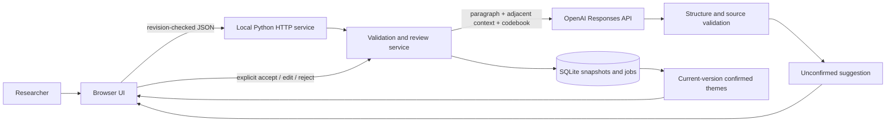

# Architecture

## Persistence contract

Documents and paragraphs preserve source IDs. Each codebook version is a snapshot of labels, definitions, inclusion rules and exclusions. Reviews reference both a paragraph and a version, and retain annotations plus reviewer notes. Model suggestions and their decisions are separate records.

SQLite transactions append full project snapshots. A caller supplies the revision it read; stale writes receive HTTP 409. The UI retains the unsaved form, but does not automatically merge conflicts. The database has no user account system and must remain local.

## Model boundary

The API adapter lives in `backend/model.py`; the model name is configured externally. Structured output is not sufficient for correctness: the service also checks allowed label IDs, unique quotations, and source coordinates. Coordinates are UTF-16 code units to match JavaScript, with explicit conversion in Python.

Only adjacent paragraphs are sent as context. Fictional independent demo excerpts suppress adjacent context. The application does not perform whole-corpus retrieval or guarantee that facts mentioned far earlier in a long interview will be available.

## Version changes

A suggestion carries its input codebook version. If rules change during generation, the result is stored under its original version and cannot be accepted against the newer rules. Publishing new rules conservatively invalidates all earlier reviews, including reviews that assigned no label. This avoids missing prior false negatives but can create unnecessary review work.

## Failure behavior

Unknown labels or unverifiable evidence prevent suggestion storage. Rejected model results are not silently converted into confirmed empty annotations. Provider HTTP errors are reported without echoing credentials or upstream request bodies. A failed request remains a failed job, and the user must explicitly request another attempt.

Only one model task is allowed in flight. On startup, unfinished jobs are marked failed. This is a synchronous local design rather than a distributed worker queue. A process failure after snapshot commit but before the job completion update is an acknowledged crash-window limitation; the system does not claim exactly-once processing across crashes.

## Recovery and limits

JSON exports contain the complete visible project. The current restore operation restores documents, paragraphs, codebooks and human reviews, and intentionally omits model suggestions and decisions. It retains the pre-restore project as an older database snapshot; there is no UI for browsing or restoring arbitrary database snapshots yet.

Complete snapshots can grow quickly. Requests are limited to 5 MB; single model inputs are limited to approximately 40,000 characters. The four-label UI, single-project design, lack of authentication, and absence of collaboration are explicit prototype limits.
